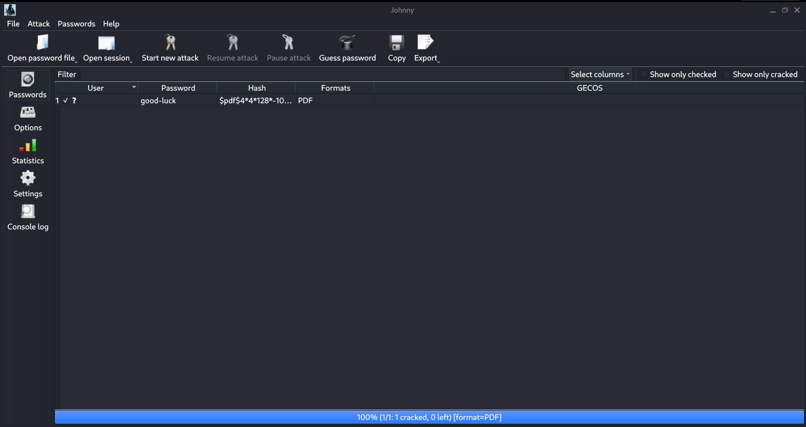
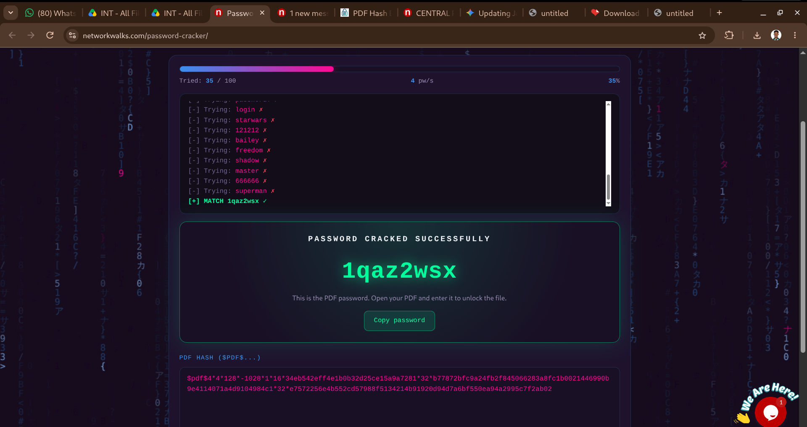
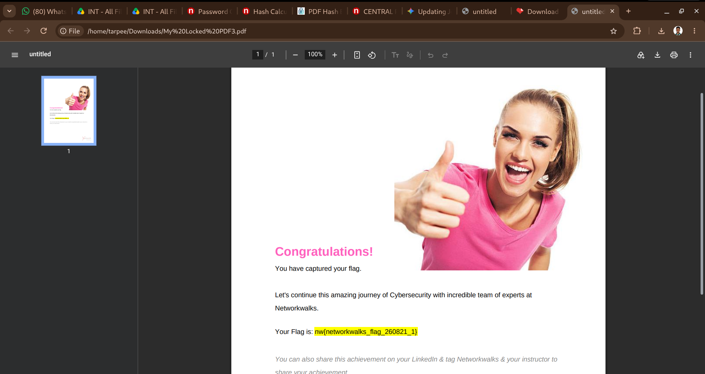

# Walkthrough: cracking a locked PDF and reading the output

This page walks through three screenshots from an authorized Networkwalks lab exercise (`My Locked PDF3.pdf`). It explains what each screen shows, what the result means, and how the three steps connect.

> **Scope:** Lab use only. The passwords, hash, and flag below come from a training PDF that was provided for this exercise. Do not reuse these passwords, and treat any real password hash as sensitive data. See the [Johnny setup guide](JOHNNY_SETUP.md) for the full permission and cleanup notes.

## The workflow in one view

1. **Extract** — Turn the locked PDF into a password hash with `pdf2john` (John the Ripper Jumbo helper).
2. **Crack** — Test candidate passwords against the hash with a dictionary/wordlist attack (Johnny GUI or the Networkwalks web cracker).
3. **Verify** — Open the original PDF with the recovered password and read the flag inside.

| Step | Tool | Input | Output |
| --- | --- | --- | --- |
| 1. Extract | `pdf2john` | `My Locked PDF3.pdf` | `$pdf$4*4*128*-1028*…` hash text file |
| 2a. Crack (GUI) | Johnny (John the Ripper) | Hash file | 1/1 cracked, format `PDF` |
| 2b. Crack (web) | networkwalks.com/password-cracker | Same-style `$pdf$…` hash | `MATCH` on guess 35 of 100 |
| 3. Verify | Browser PDF viewer | Recovered password | Unlocked PDF with flag |

---

## 1. Johnny GUI — attack finished, 1 of 1 cracked

### What you are seeing

- **Top menus and toolbar:** `File`, `Attack`, `Passwords`, `Help`, plus actions such as **Open password file**, **Open session**, **Start new attack**, **Resume attack**, **Pause attack**, **Guess password**, **Copy**, and **Export**. `Resume attack` and `Pause attack` are greyed out because no attack is currently running.
- **Left navigation:** `Passwords` (active), `Options`, `Statistics`, `Settings`, `Console log`.
- **Results table:** One row is loaded:
  - **User:** `?` (no username is stored in a PDF hash file — the `?` means unknown/not applicable)
  - **Password:** `good-luck` (the recovered password for this run)
  - **Hash:** `$pdf$4*4*128*-10…` (truncated display; the full `$pdf$…` string is in the hash file)
  - **Formats:** `PDF` (Johnny correctly detected the hash format)
  - **GECOS:** empty (no extra account info, as expected for a PDF)
- **Status bar (bottom, blue):** `100% (1/1: 1 cracked, 0 left) [format=PDF]`

### What the output means

- **1 hash loaded, 1 cracked, 0 left** — the attack has finished and every loaded hash was recovered. `100%` confirms completion, not just progress.
- **`[format=PDF]`** — John used the PDF format module to test candidates, which means the hash file was in the right shape and the installed John build supports PDF hashes.
- **A filled-in Password column** — John found a candidate whose hash matches the stored hash. That is the definition of a successful recovery: the candidate reproduces the hash, so it is (with overwhelming probability) the PDF password.
- **Greyed-out Resume/Pause** — there is nothing left to resume or pause because the run is done.

### What to check next

- Copy the recovered password from the Password column and try it on the original PDF (Step 3).
- Use **Export** or **Copy** if you need to save the result, and keep the hash file private until you clean it up.

---

## 2. Networkwalks web cracker — dictionary attack hits on guess 35

### What you are seeing

- **Progress bar and counters:** `Tried: 35 / 100`, `4 pw/s` (4 passwords per second), `35%`. The bar is about one-third full because the run stopped early on a match.
- **Attempt log (top box):** Each line is one candidate test:
  - `[-] Trying: login x`, `[-] Trying: starwars x`, `[-] Trying: 121212 x`, `[-] Trying: bailey x`, `[-] Trying: freedom x`, `[-] Trying: shadow x`, `[-] Trying: master x`, `[-] Trying: 666666 x`, `[-] Trying: superman x` — the `x` marks a failed guess.
  - `[+] MATCH 1qaz2wsx ✓` — the final line in green marks the successful guess.
- **Result banner:** `PASSWORD CRACKED SUCCESSFULLY` with the password `1qaz2wsx` in large green text, plus a **Copy password** button and the note “This is the PDF password. Open your PDF and enter it to unlock the file.”
- **Hash box (bottom):** Labelled `PDF HASH ($PDF$…)` and showing the full `$pdf$4*4*128*-1028*…` hash that was tested. (The full string is visible in the screenshot; this write-up only shows a truncated prefix.)

### What the output means

- **A dictionary attack in action:** The tool tried common passwords one by one (`login`, `starwars`, `121212`, …). Most failed (`[-] … x`); the one that reproduced the hash succeeded (`[+] MATCH … ✓`).
- **Stopped at 35 of 100:** The cracker did not need to test all 100 candidates. It stopped as soon as it found the match, which is why the progress shows 35%.
- **`1qaz2wsx` is a very weak password:** It is a keyboard-pattern password (`1qaz` down the left column, `2wsx` down the next) and appears in common-password lists. That is exactly why a short dictionary attack recovered it quickly — at 4 guesses per second, 35 guesses take only a few seconds.
- **The hash box proves the target:** The `$pdf$…` string confirms the input was a PDF password hash in John format, matching the format Johnny reported in Step 1.

### A note on the two passwords

The Johnny screenshot (Step 1) shows `good-luck`, while this web screenshot shows `1qaz2wsx`. Treat them as **two separate runs** (different files, wordlists, or lab attempts) rather than two passwords for one hash — a single hash has one password. The lesson is the same either way: a weak, dictionary-listed password falls quickly, while a strong unique password would not.

---

## 3. PDF unlocked — recovered password verified, flag captured

### What you are seeing

- **File and viewer:** The browser is viewing `/home/tarpee/Downloads/My Locked PDF3.pdf`, page `1 / 1`, at 100% zoom. The fact that the document opens at all proves the recovered password was correct.
- **Page content:** A “Congratulations!” heading, the text “You have captured your flag.”, and a note inviting you to continue the cybersecurity journey with Networkwalks.
- **Flag (highlighted in yellow):** `nw{networkwalks_flag_260821_1}`

### What the output means

- **Verification passed:** Cracking is only useful if the password actually unlocks the file. Opening the PDF with the recovered password and seeing its contents is the proof that Steps 1–2 worked.
- **Flag captured:** The flag inside the PDF is the lab’s completion marker. The `nw{…}` format is Networkwalks’ flag style, and the number `260821` matches the exercise date/ID.
- **End-to-end success:** Extract → crack → unlock → flag. If the password had been wrong, the PDF viewer would have rejected it and shown no content.

---

## Summary of outputs

| Screenshot | Key output | Meaning |
| --- | --- | --- |
| Johnny GUI | `100% (1/1: 1 cracked, 0 left) [format=PDF]`, Password `good-luck` | GUI attack finished; the single PDF hash was recovered. |
| Web cracker | `Tried: 35 / 100`, `[+] MATCH 1qaz2wsx ✓` | Dictionary attack succeeded on the 35th common-password guess. |
| Unlocked PDF | `Congratulations! … nw{networkwalks_flag_260821_1}` | Recovered password opens the PDF; flag captured. |

## Lessons

- **Weak passwords fall fast.** Both recovered passwords are short, common, or keyboard-pattern strings. A long, unique password would have resisted these dictionary runs.
- **Format detection matters.** Johnny’s `[format=PDF]` and the `$pdf$…` prefix confirm the hash was extracted correctly before cracking.
- **Always verify.** The final proof is opening the original file — a match in a tool is only a claim until the PDF opens.
- **Handle hashes carefully.** Even lab hashes should be kept private and deleted when no longer needed, as described in the [setup guide](JOHNNY_SETUP.md).
